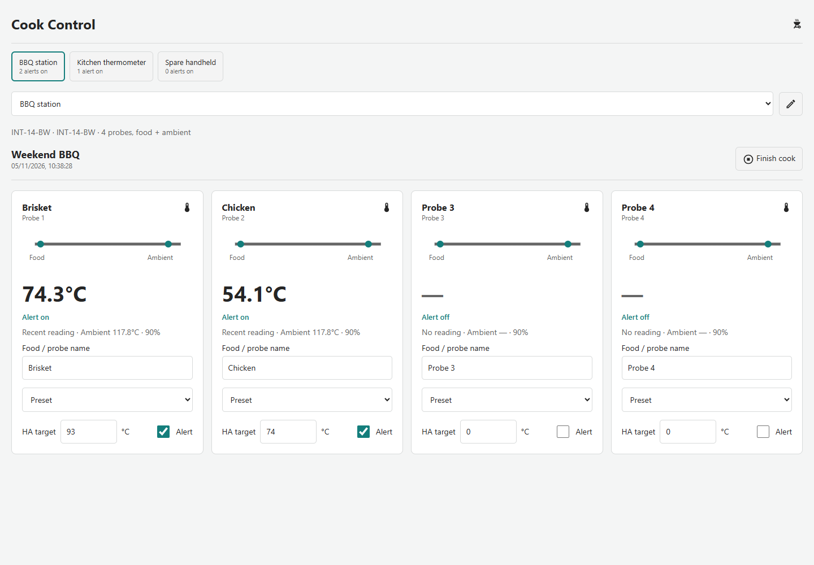
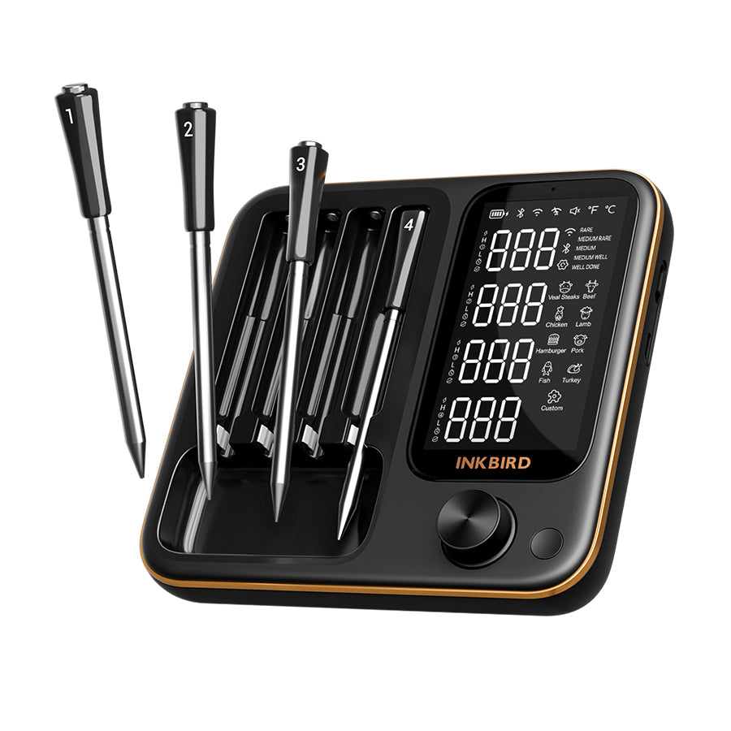

# Inkbird INT

Food thermometers in Home Assistant. Follow your probe temperatures, keep a history of the cook and use the local controls supported by your model.

[Install](#install-the-integration) &nbsp; / &nbsp; [Cook Control](#cook-control) &nbsp; / &nbsp; [Models](#find-your-model) &nbsp; / &nbsp; [Help](#help-and-community) &nbsp; / &nbsp; [Support](#support-the-project)

## Cook Control

Use your **INT-14-BW and IHT-2PB thermometers together**. Each keeps its own food names, targets and alerts. Switching thermometer changes only the view: the other cooks keep running.

  

*Cook Control 1.2 preview with sample readings. Tap to enlarge, or see the [IHT-2PB mobile view](https://raw.githubusercontent.com/zampix1/ha-inkbird-int14/main/docs/images/cook-control-multi-iht.png).*

**Your food names, not device codes.** Call a probe "Brisket" and that is the name used in its announcement. INT-14-BW shows four probes with food and ambient readings. Each IHT-2PB shows its built-in tip and two wired probes, through the [separate IHT integration](https://github.com/zampix1/ha-inkbird-iht2pb-local). Other INT layouts are not mapped by Cook Control yet.

**Keep the cook, not just the current temperature.** Start a named session, then revisit its graph, target changes and alerts in History. Download readings as CSV or the full session as JSON. Archives stay in HA, independently of Recorder cleanup.

**[Download Cook Control 1.2.1 preview](https://github.com/zampix1/ha-inkbird-int14/releases/download/v0.2.12-rc.1/inkbird-cook-control-1.2.1.zip)** &nbsp; / &nbsp; **[Install guide](https://github.com/zampix1/ha-inkbird-int14/blob/main/examples/cook_control/README.md)** &nbsp; / &nbsp; **[Guida italiana](https://github.com/zampix1/ha-inkbird-int14/blob/main/examples/cook_control/README.it.md)**

Start with working thermometer entities. The ZIP contains the optional Cook Control backend, YAML package and dashboard files; the new cards do not need button-card, card-mod or mini-graph-card. **HACS installs the thermometer integration, not this separate bundle.** Keep stable v0.2.10 or v0.2.11 if it works for you and install just the ZIP. The backend currently requires an administrator HA account.

**Echo speaks; the TV shows silent text.** Use one Echo or an explicit announcement group, leaving bedrooms out. Native Alexa announcements use Alexa Media Player, not OpenAI. Each output now has its own queue and result: a slow TV or Echo cannot hold up the other cooks. A failed output can be retried without repeating messages already accepted.

**Stall and rest are back on each probe card.** Choose the stall duration, maximum temperature change and minimum temperature; set automatic rest locally or inherit the common default. The device page also restores the controls actually exposed by your thermometer's integration.

**The first 1.2.0 bundle has been withdrawn.** This 1.2.1 preview fixes the audit findings. Three-device automated tests and installation checks on HA pass; fresh-device threshold crossings and physical Echo/TV confirmation are still pending. Targets and Echo/TV settings survive the upgrade. See the [test notes](https://github.com/zampix1/ha-inkbird-int14/blob/main/examples/cook_control/VALIDATION.md).

## Find Your Model

Select the model printed on your device, not the closest-looking station. These are the models with real-device reports:

<table>
  <tr>
    <td align="center"> <strong>INT-14-BW</strong> 4 probes &middot; 8 temperatures Local BLE and Tuya LAN. Tested baseline, including local controls.</td>
    <td align="center"> <strong>INT-14S-BW</strong> 4 probes &middot; 20 temperatures Community-validated BLE; experimental Tuya LAN. Normal operation is read-only.</td>
  </tr>
  <tr>
    <td align="center"> <strong>INT-12E-BW</strong> 2 probes &middot; 10 temperatures Community-validated BLE, including ESPHome proxies. Read-only temperatures and batteries.</td>
    <td align="center"> <strong>INT-11I-B</strong> 1 mapped probe temperature Experimental, community-tested GATT reads. Read-only temperature and base/probe batteries.</td>
  </tr>
</table>

Station temperature is additional where supported. Other profiles are **cataloged only** unless the [full model guide](https://github.com/zampix1/ha-inkbird-int14/blob/main/docs/model_profiles.md) says otherwise: listing a model does not enable live readings or writes. INT-14S has separate, disabled-by-default diagnostic write tests, not normal settings controls.

## Install The Integration

Inkbird INT is in the **default HACS catalog**. No custom repository is needed.

1. Search for **Inkbird INT** in HACS and download it. On Home Assistant 2026.11 or newer, open **Settings > Marketplace** instead: HACS is built in there, with the same catalog.
2. Restart Home Assistant when no cook depends on it.
3. Go to **Settings > Devices & services > Add integration**, choose **Inkbird INT** and select your exact model.

Already installed? Update through HACS; keep your existing entry and pairing. Cook Control is a separate optional setup, not a replacement for the integration. Without HACS, use the [manual installation guide](https://github.com/zampix1/ha-inkbird-int14/blob/main/docs/configuration.md#manual-installation).

**Bluetooth is the easiest place to start.** Use HA's local adapter or an optional ESPHome Bluetooth Proxy near the station. Close the Inkbird app if it is competing for the connection. [Bluetooth setup](https://github.com/zampix1/ha-inkbird-int14/blob/main/docs/bluetooth_proxy.md).

**Local Wi-Fi needs your station's credentials.** Supply its host/IP, device ID, local key, protocol version (usually 3.5 on the tested INT-14-BW) and polling interval. The integration does not retrieve keys for you, and Wi-Fi working in the app does not prove that a model's local protocol is supported. [Where to find the LAN details](https://github.com/zampix1/ha-inkbird-int14/blob/main/docs/lan_setup.md).

Optional cloud history is off by default, experimental and read-only. It covers DP109 history on supported profiles, **not live cloud control or writes**. [Cloud history limits](https://github.com/zampix1/ha-inkbird-int14/blob/main/docs/cloud_history_experimental.md).

## A Few Practical Limits

- **An adapter does not have to be an ESP32.** The USB/local Bluetooth adapter works too, provided it can reach the station.
- **Battery percentages are not independent measurements.** A station can report 100% for a long time; quality diagnostics flag suspicious plateaus.
- **Updates can arrive between polls.** INT-12E notifications are immediate; its configurable direct-read interval is a fallback. The station may close BLE sessions after about 30 seconds, and the integration reconnects.

For transport selection, available controls and diagnostics, see the [configuration guide](https://github.com/zampix1/ha-inkbird-int14/blob/main/docs/configuration.md). INT-14-BW retains its validated local unit, display, target, pre-alarm, timer and calibration operations; availability depends on transport and device data.

## Help And Community

[User guides](https://github.com/zampix1/ha-inkbird-int14/wiki) &nbsp; / &nbsp; [Ask a question](https://github.com/zampix1/ha-inkbird-int14/discussions) &nbsp; / &nbsp; [Report a bug](https://github.com/zampix1/ha-inkbird-int14/issues/new?template=bug_report.yml)

Using an **INT-12E-BW**? [@Nexus1212's multisensor dashboard](https://github.com/zampix1/ha-inkbird-int14/blob/main/docs/int12e_dashboard.md) has a guide, screenshots and example YAML for its ten channels. You can also use the integration's entities in your own cards and automations.

Real-device reports help other owners. Include your exact model, connection, physical probe count and which readings worked. The [validation template](https://github.com/zampix1/ha-inkbird-int14/discussions/new?category=q-a) asks for channel-mapping tests where needed. Remove addresses, IDs, keys, tokens, Wi-Fi names and identifying entity IDs before posting diagnostics; never upload a Tuya `devices.json`. [Private security reports](https://github.com/zampix1/ha-inkbird-int14/blob/main/SECURITY.md).

## Support The Project

If this is useful in your home, you can help with a real-device report, a fix, a GitHub star or a coffee.

---

An independent community project, not affiliated with or endorsed by Inkbird. The repository remains `ha-inkbird-int14` and the integration domain remains `inkbird_int14`.

Device communication and protocol handling are maintained here. Cook Control's visual base is adapted from Remco's MIT-licensed dashboard, with its design credits preserved. [Dashboard sources](https://github.com/zampix1/ha-inkbird-int14/blob/main/examples/cook_control/THIRD_PARTY_NOTICES.md) &middot; [BLE authentication and product photo credits](https://github.com/zampix1/ha-inkbird-int14/blob/main/THIRD_PARTY_NOTICES.md).
